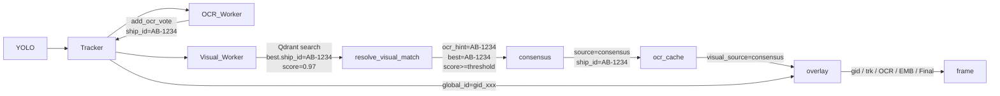

# OCR + Embedding Consensus Fusion & Enhanced Overlay

**Date:** 2026-06-22  
**Scope:** Server AI pipeline + frontend overlay  
**Files changed:** ~7 files

---

## Problem

Currently, OCR and Qdrant visual embedding run in parallel but fuse via a strict priority rule: OCR hint present → use OCR unconditionally, suppress visual result. This means:
- A high-confidence visual match is silently discarded when OCR fires, even if both agree
- When both disagree, OCR always wins regardless of visual confidence
- The overlay mislabels the plate text as "GID", doesn't show the real `global_id`, and doesn't show the final decision source

---

## Goal

1. **Consensus fusion**: if both OCR and embedding return the same ship ID → lock it immediately with boosted confidence. If only one fires → use that one. If both disagree → embedding wins only when its score ≥ `visual_conflict_threshold` (configurable), otherwise OCR wins.
2. **Enhanced overlay**: show `global_id` (real `gid_*`), OCR result, embedding result, and final confirmed ID with source tag — on both dashboard group preview and single-camera frames.

---

## Approach

Approach A — extend `resolve_visual_match` in-place. Both workers already run in parallel; only the fusion function changes.

---

## Section 1: Fusion Logic

**File:** `server/app/utils/ai/visual_ship_matching.py`

### Changes to `resolve_visual_match`

Add param: `conflict_threshold: float = 0.96`

Decision matrix (replaces current `if normalized_ocr:` branch):

| OCR present | Visual present | Condition | `source` | `ship_id` |
|-------------|----------------|-----------|----------|-----------|
| Yes | Yes | same ID | `consensus` | shared ID, conf = min(1.0, visual_score + 0.05) |
| Yes | Yes | different, visual_score ≥ conflict_threshold | `conflict-visual-wins` | visual ID |
| Yes | Yes | different, visual_score < conflict_threshold | `conflict-ocr-wins` | OCR ID |
| Yes | No hits | — | `ocr-hint` | OCR ID (unchanged) |
| No | Yes | score ≥ match_threshold | `visual` | visual ID (unchanged) |
| No | No | — | `unknown` | None (unchanged) |

`visual_score` = `best.aggregated_score` (mean of top-m Qdrant point scores).

The `source` string flows into `ocr_cache['visual_source']` via `_on_visual_result`, and then into the overlay `Final:` label.

### `IdentityFusion`

**File:** `server/app/services/ai/identity_fusion.py`

Add `conflict_threshold: float = 0.96` to `__init__` and pass to `resolve_visual_match(conflict_threshold=self._conflict_threshold)`.

---

## Section 2: Config — `visual_conflict_threshold`

### DB (`schema_patches.py`)

Add to the `_DINOV2_PORT_CONFIG_VALUES` dict (line ~621):

```python
'visual_conflict_threshold': (
    '0.96',
    'Minimum visual embedding score to override OCR when both methods disagree.',
),
```

This dict is iterated by the `seed_dinov2_port_configs` patch function which uses `INSERT ... ON CONFLICT (key) DO NOTHING`, so it's safe to add here.

### Backend load (`pipeline_service.py`)

In `_load_runtime_cfg` (around line 450):
```python
'visual_conflict_threshold': self._to_float(
    cfg_map.get('visual_conflict_threshold', ''), 0.96
),
```

Pass to `IdentityFusion`:
```python
self._identity_fusion = IdentityFusion(
    match_threshold=runtime_cfg['visual_match_threshold'],
    conflict_threshold=runtime_cfg['visual_conflict_threshold'],
)
```

### Frontend (`PortConfigsSection.tsx`)

In `KEY_PREFIX_MAP`:
```ts
visual_conflict_threshold: 'visual',
```

The existing generic config UI renders this automatically in the "Visual ID" category. No other frontend changes needed.

---

## Section 3: Overlay

### 3a. `TrackedBoat` — add `global_id` field

**File:** `server/app/services/ai/boat_tracker.py`

```python
@dataclass
class TrackedBoat:
    ...
    global_id: str | None = None   # gid_* from CrossCameraReIdManager; None in single-cam mode
```

### 3b. `CrossCameraReIdManager` — add `get_global_id` helper

**File:** `server/app/services/ai/cross_camera_reid.py`

```python
def get_global_id(self, camera_id: int, track_id: str) -> str | None:
    """Return the gid_* for this track, or None if not yet mapped."""
    with self._lock:
        return self._track_to_global.get((int(camera_id), str(track_id)))
```

### 3c. `PerCameraPipeline._enrich_track` — populate `global_id`

**File:** `server/app/services/ai/per_camera_pipeline.py`

After existing `get_global_ship_id` call, add:
```python
track.global_id = self._reid_manager.get_global_id(
    int(self.config.camera_id), track.track_id
)
```

### 3d. Overlay rendering

**File:** `server/app/utils/ai/overlay.py`

Replace current per-track header block (lines 114–136) with:

```
# Above bbox (4 lines stacked, top to bottom):
Line 1 (y - 86):  gid: {tb.global_id or tb.track_id}           color: (200, 160, 255)  ← purple
Line 2 (y - 62):  trk: {tb.track_id} [{state}]                  color: (180, 180, 180)  ← gray  
Line 3 (y - 38):  det: {conf:.2f}                               color: (180, 220, 255)  ← unchanged

# Below bbox (existing block, minor rename VEC→EMB):
Line 4 (y + 24):  OCR: {text}                                   color: (0, 220, 255)    ← unchanged
Line 5 (y + 44):  EMB: {visual_ship_id} ({conf:.1f}%)           color: (120, 255, 120)  ← renamed from VEC
Line 6 (y + 64):  Final: {tb.ship_id or 'N/A'} [{source}]      color: (255, 220, 80)   ← new yellow
```

`source` = `ent.get('visual_source', '?')` from `ocr_cache`. Fallback to `'ocr'` if only OCR set `tb.ship_id` (no visual entry in cache).

**`fused_track_overlay.py`** — also add `global_id` line to the fused multi-camera preview (currently only shows `ship_id` or `T{track_id}`):
```
gid: {track.global_id or track.track_id}
{ship_id or T{track_id}}
```

---

## Data Flow (updated)



---

## Files Changed Summary

| File | Change |
|------|--------|
| `server/app/utils/ai/visual_ship_matching.py` | Add `conflict_threshold` param, new decision matrix |
| `server/app/services/ai/identity_fusion.py` or `visual_id_worker.py` | Pass `conflict_threshold` through |
| `server/app/services/pipeline_service.py` | Load `visual_conflict_threshold` from config, pass to `IdentityFusion` |
| `server/app/db/schema_patches.py` | Add `visual_conflict_threshold` default row |
| `server/app/services/ai/boat_tracker.py` | Add `global_id: str | None = None` field |
| `server/app/services/ai/cross_camera_reid.py` | Add `get_global_id()` method |
| `server/app/services/ai/per_camera_pipeline.py` | Set `track.global_id` in `_enrich_track` |
| `server/app/utils/ai/overlay.py` | New 6-line overlay, rename VEC→EMB, add Final line |
| `server/app/utils/ai/fused_track_overlay.py` | Add `global_id` line |
| `client/src/features/port/components/PortConfigsSection.tsx` | Add `visual_conflict_threshold: 'visual'` to KEY_PREFIX_MAP |

---

## Non-goals

- No change to OCR worker, Qdrant enrollment, or DB schema for detections/port_logs
- No change to cross-camera Re-ID track matching (embedding extractor for IoU handoff)
- No frontend visualization changes beyond the config key mapping

---

## Edge Cases

- **Single-camera mode** (no `CrossCameraReIdManager`): `track.global_id` stays `None`; overlay line 1 falls back to `tb.track_id`
- **Visual worker disabled** (`enable_visual_id=false`): `visual_source` absent from cache; `Final:` shows OCR with source `'ocr'`
- **Both absent**: `Final: N/A [unknown]`
- **`consensus` in single-cam mode without visual**: can't happen — if visual disabled, no visual result enters cache
